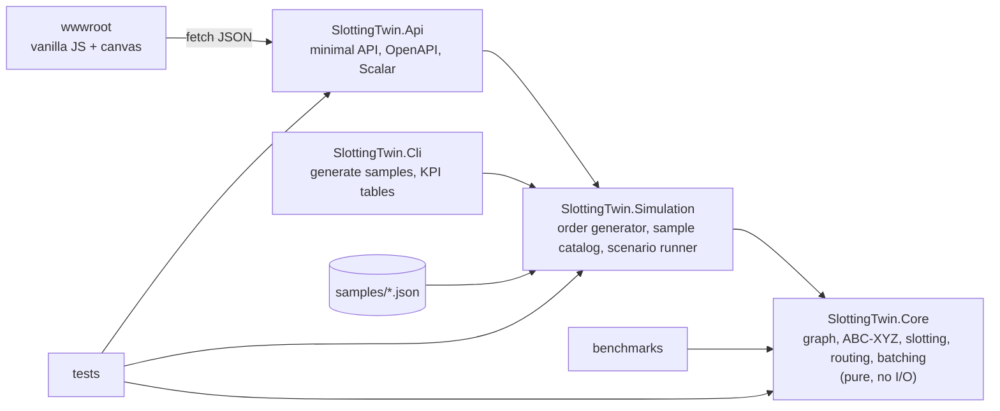

# Slotting Twin

A small warehouse digital twin for the two decisions a WMS makes over and over:

- **Put-away / slotting**: which storage location should each SKU live in?
- **Picking**: in which order should a picker visit the locations of an order, and which orders should share a cart?

The project models a parallel-aisle warehouse as a graph, replays an order history on it and measures how far pickers
walk under different slotting and routing strategies. It ships with a canvas UI that shows the warehouse as a heat map
and animates the picker route before and after optimization.

Stack: C# / .NET 10, ASP.NET Core minimal API, vanilla JS (ES modules) + canvas, xUnit v3, BenchmarkDotNet.
No database: layouts and order histories are JSON files in `samples/`.

## Glossary

| Term | Meaning |
|---|---|
| Slotting | Assigning SKUs to storage locations. Good slotting puts fast movers where they are cheap to reach. |
| COI | Cube-per-order index: storage space an SKU needs divided by how often it is picked. Low COI = small and popular = near the depot. |
| ABC analysis | Rank SKUs by picks: A = the SKUs that make up the first 80 % of picks, B = the next 15 %, C = the rest (thresholds configurable). |
| XYZ analysis | Classify demand stability by the coefficient of variation (std / mean) of demand per period: X ≤ 0.5 steady, Y ≤ 1.0 variable, Z erratic. |
| S-shape (traversal) | Walk every aisle that contains a pick from end to end, alternating direction. |
| Return | Enter each aisle with picks from the front, go to the farthest pick, come back the same way. |
| Largest gap | Traverse the first and last aisle completely; enter the aisles in between from the back and from the front, each time up to the largest empty stretch between stops, so that stretch is never walked. |
| Nearest neighbour | Always walk to the closest unvisited pick (shortest-path distance). |
| 2-opt | Local search on a tour: reverse a segment whenever that makes the tour shorter, until no reversal helps. |
| Order batching | Picking several orders in one tour with one cart. |

## Architecture



| Project | Responsibility |
|---|---|
| `src/SlottingTwin.Core` | Pure algorithms. `WarehouseGraph`, `AbcXyzAnalyzer`, `ISlottingStrategy` (4 implementations), `IRoutingStrategy` (5 implementations), `SeedBatcher`. |
| `src/SlottingTwin.Simulation` | Seeded order-history generator, JSON sample catalog, `ScenarioRunner` (slot → route every order → KPIs). |
| `src/SlottingTwin.Api` | Minimal API + static UI in `wwwroot/`. |
| `src/SlottingTwin.Cli` | Regenerates `samples/` and prints the KPI tables below. |
| `tests/SlottingTwin.Tests` | xUnit v3 + Shouldly: hand-computed examples, brute-force checks, API tests. |
| `benchmarks/SlottingTwin.Benchmarks` | BenchmarkDotNet: routing strategies on 10 / 50 / 200 picks. |

Routing and slotting use the Strategy pattern: every heuristic implements one small interface, and the API, CLI,
benchmarks and tests all enumerate `RoutingStrategies.All` / `SlottingStrategies.All`.

## The model

**Layout.** `aisles × baysPerAisle × levels`, racks on both sides of every aisle, a front cross-aisle and an optional
back cross-aisle, depot on the front cross-aisle at the head of `depotAisle`. Levels carry a slot volume and a weight
limit; the samples use `1.2 m³ / 1000 kg` (floor), `1.0 m³ / 25 kg`, `0.6 m³ / 10 kg`, which is how "heavy items low" is enforced.

**Graph.** Each aisle is a column of nodes: slot 0 joins the front cross-aisle, slots 1..B are the bays, slot B+1 joins the
back cross-aisle. Both rack sides and all levels of a bay share one node (walking distance ignores side and height).
Edges are one bay width along an aisle and one aisle spacing along a cross-aisle. Shortest paths come from Dijkstra
(`PriorityQueue`), computed lazily per source node and cached; `DistanceMatrix(nodes)` builds the k×k matrix a pick list needs.
A route is a list of waypoints from depot to depot; its length is the sum of shortest paths between consecutive waypoints.
Aisle heuristics add cross-aisle junctions as waypoints to force "walk through this aisle" behaviour.

## Algorithms and complexity

n = SKUs, m = locations, k = picks in one list, V = graph nodes (≤ 40 × 62).

| Algorithm | What it does | Cost |
|---|---|---|
| Dijkstra | Shortest walking distance from one node to all others | O(V log V) per source, cached |
| ABC | Sort SKUs by picks; A while the pick share ranked above the SKU is still below 80 %, B below 95 %, else C. SKUs without picks are C | O(n log n) |
| XYZ | CV of demand per period (default weekly; a shorter last period is compared by daily rate) | O(n · periods) |
| Random / alphabetical slotting | Baselines: first free location that fits, in random or SKU-id order | O(n · m) |
| COI slotting | SKUs by ascending COI into locations by ascending distance from depot (then level), first fit | O(n log n + n · m) |
| COI + co-occurrence swaps | Start from COI; pairwise swap local search on J = Σ picks(s)·d(depot,s) + w·Σ together(s,t)·d(s,t) over the 200 most-picked SKUs, only swaps that keep both SKUs' volume/weight limits | O(passes · c² · degree) |
| S-shape, return, largest gap | Group picks by aisle, emit waypoints aisle by aisle | O(k log k) + k path lookups |
| Nearest neighbour | Greedy tour on the k×k distance matrix | O(k²) + k Dijkstra rows |
| 2-opt | First-improvement segment reversals starting from nearest neighbour; never longer than its start | O(k²) per pass |
| Seed batching | Open a cart with the order spanning most aisles, add the order adding fewest new aisles while lines ≤ capacity | O(N² · a) for N orders |

## Results

Produced with `dotnet run --project src/SlottingTwin.Cli -- run <sample> --seed 42` on the shipped samples
(order histories generated with seed 42; the scenario seed drives random slotting). Distances are metres walked along
aisle centre lines over the whole 28-day history, one tour per order. Baseline = random slotting + S-shape.

**compact**: 8 aisles × 12 bays × 3 levels (576 slots), 400 SKUs, 1,091 orders, depot at the corner.

| Slotting | Routing | Total distance (m) | Avg per order (m) | Picks per m | vs baseline |
|---|---|--:|--:|--:|--:|
| random | s-shape | 66,522 | 61.0 | 0.039 | 0.0 % |
| random | 2-opt | 62,040 | 56.9 | 0.042 | 6.7 % |
| alphabetical | s-shape | 56,126 | 51.4 | 0.046 | 15.6 % |
| coi | s-shape | 35,002 | 32.1 | 0.074 | 47.4 % |
| coi | return | 31,204 | 28.6 | 0.083 | 53.1 % |
| coi | 2-opt | 29,732 | 27.3 | 0.087 | 55.3 % |
| coi-swap | s-shape | 29,654 | 27.2 | 0.088 | 55.4 % |
| coi-swap | 2-opt | 25,138 | 23.0 | 0.103 | **62.2 %** |

**wide**: 16 aisles × 24 bays × 3 levels (2,304 slots), 1,500 SKUs, 3,403 orders, depot in the middle.

| Slotting | Routing | Total distance (m) | Avg per order (m) | Picks per m | vs baseline |
|---|---|--:|--:|--:|--:|
| random | s-shape | 386,410 | 113.5 | 0.021 | 0.0 % |
| random | return | 394,990 | 116.1 | 0.020 | -2.2 % |
| random | 2-opt | 344,906 | 101.4 | 0.023 | 10.7 % |
| coi | s-shape | 190,298 | 55.9 | 0.042 | 50.8 % |
| coi | largest-gap | 186,724 | 54.9 | 0.043 | 51.7 % |
| coi | return | 136,702 | 40.2 | 0.059 | 64.6 % |
| coi | 2-opt | 133,510 | 39.2 | 0.060 | 65.4 % |
| coi-swap | 2-opt | 122,468 | 36.0 | 0.065 | **68.3 %** |

So on sample *wide*, seed 42, **COI + 2-opt cuts travel by 65.4 %** against random + S-shape, and adding the
co-occurrence swaps takes it to **68.3 %**. Expected single-pick round trip drops from 59.9 m (random) to 20.0 m (COI)
and 19.1 m (COI + swaps).

What the numbers say:

- **Slotting matters more than routing.** With random slotting the best router saves 7–11 %; COI alone saves 47–51 % even with S-shape.
- **The best router depends on the slotting.** With random slotting, return is worse than S-shape. Once COI packs the
  fast movers near the front, picks sit close to the front cross-aisle and return beats S-shape by a wide margin
  (136,702 m vs 190,298 m on *wide*); walking whole aisles is wasted.
- **2-opt is never worse than nearest neighbour** (guaranteed by construction and tested), but the gain over it is small (0.3–1.3 %).
- **Co-occurrence swaps help** (a further 8–15 % less than COI with the same router) because the generator builds orders around product families. Real data with weaker affinity would gain less.

Order batching (seed algorithm, cart capacity 20 lines; about 8.4 orders per cart):

| Sample | Slotting + routing | Single-order (m) | Batched (m) | Carts | Saving |
|---|---|--:|--:|--:|--:|
| compact | random + s-shape | 66,522 | 11,238 | 130 | 83.1 % |
| compact | coi-swap + 2-opt | 25,138 | 5,378 | 130 | 78.6 % |
| wide | random + s-shape | 386,410 | 77,264 | 402 | 80.0 % |
| wide | coi-swap + 2-opt | 122,468 | 33,526 | 402 | 72.6 % |

The saving is large because the average order has only 2.4 lines, so one-order-per-tour is a weak baseline.

ABC-XYZ matrix of the *compact* history (weekly periods):

| ABC \ XYZ | X | Y | Z |
|---|--:|--:|--:|
| A | 44 | 76 | 20 |
| B | 3 | 47 | 79 |
| C | 0 | 3 | 128 |

## Benchmarks

One pick list in a 20 × 30 warehouse (600 pick nodes), depot mid-front. Shortest-path rows are warmed in setup,
so this measures the routing heuristics, not Dijkstra. Run with `--job short` (3 iterations), so treat the numbers
as rough: BenchmarkDotNet v0.15.8, .NET 10.0.15, Intel Core i5-13420H, Windows 11.

| Strategy | 10 picks | 50 picks | 200 picks | Allocated (200) |
|---|--:|--:|--:|--:|
| s-shape | 2.8 µs | 9.4 µs | 26.2 µs | 16.4 KB |
| return | 2.6 µs | 9.2 µs | 23.5 µs | 15.6 KB |
| largest-gap | 3.3 µs | 12.0 µs | 29.2 µs | 21.7 KB |
| nearest-neighbor | 2.0 µs | 22.2 µs | 383 µs | 325 KB |
| 2-opt | 2.6 µs | 41.3 µs | 741 µs | 327 KB |

The aisle heuristics grow roughly linearly with the pick count; nearest neighbour and 2-opt grow quadratically and
allocate a (k+1)² distance matrix, which at 200 picks lands on the large object heap (the Gen2 collections in the raw report).
At 10 picks the differences are within the noise of a short run.

## How to run

Requires the .NET 10 SDK. Run from the repository root.

```powershell
dotnet build                      # TreatWarningsAsErrors is on
dotnet test                       # xUnit v3 on Microsoft.Testing.Platform (see global.json)

# UI + API: open http://localhost:5187 (API reference at /scalar, OpenAPI at /openapi/v1.json)
dotnet run --project src/SlottingTwin.Api --urls http://localhost:5187

# KPI tables (the Results section) and sample regeneration
dotnet run --project src/SlottingTwin.Cli -- run wide --seed 42
dotnet run --project src/SlottingTwin.Cli -- generate

# Benchmarks (Release; a full run takes several minutes, --job short is quicker)
dotnet run -c Release --project benchmarks/SlottingTwin.Benchmarks -- --filter "*"
```

### API

| Endpoint | Purpose |
|---|---|
| `GET /api/layouts` | Sample layouts: dimensions for drawing, SKU/order counts, order ids |
| `GET /api/strategies` | Slotting and routing strategy names |
| `GET /api/abc?layout=compact&slotting=coi&seed=42` | ABC-XYZ matrix plus every location with its SKU, picks and class |
| `POST /api/simulate` | `{ "layout", "slotting", "routing", "seed", "cartCapacity"? }` → baseline vs candidate KPIs and improvement % |
| `POST /api/route` | `{ "layout", "slotting", "routing", "seed", "orderId"? }` → stops, distance and the node-by-node path in metres |

Inputs are validated at the boundary and rejected with an RFC 9457 validation problem (HTTP 400): layouts and strategies
must exist, cart capacity must be 1–100 lines and hold the largest order, and S-shape / largest gap are refused on layouts without a back cross-aisle. Layout files are validated on load
(max 40 aisles × 60 bays × 8 levels, 20,000 SKUs, 100,000 orders), so no request can make the server build a huge warehouse.

### UI

`src/SlottingTwin.Api/wwwroot/`: plain HTML, CSS and ES modules, no build step. Two canvases show the same order
before (random + S-shape) and after (selected strategies): racks coloured by the ABC class of the SKUs in each bay, colour
strength by pick count, numbered stops, animated picker. Native form controls with labels, visible focus, an `aria-live`
status line, `role="img"` canvases with a text summary, light/dark theme, and no animation under `prefers-reduced-motion`.

## Tests

110 tests, all green. Highlights:

- Distances on a 3-aisle layout computed by hand (front vs back cross-aisle, no back aisle), and Dijkstra equal to the closed-form distance for every node pair on three layouts.
- S-shape, return, largest gap and nearest neighbour on hand-computed pick lists (28 m, 24 m, 24 m, 24 m).
- For every router and 40 random pick lists: starts and ends at the depot, visits every pick exactly once, reported distance equals the walked path.
- No heuristic beats the brute-force optimal tour (exhaustive search, up to 6 picks); 2-opt is never worse than nearest neighbour over 100 lists.
- ABC on a textbook 50/30/10/5/3/2 dataset, XYZ on hand-computed CVs (0, 0.8, √3), weekly vs daily periods.
- Every slotting strategy respects volume and weight limits (heavy and bulky SKUs only on the floor); COI beats random and alphabetical on expected travel; the swap search lowers its own objective and pulls co-ordered SKUs into one bay.
- Batches never exceed cart capacity and contain every order once.
- API: every endpoint, validation errors per field, static UI files, OpenAPI and Scalar.

## Limitations

- Synthetic data only. The generator is designed to have Pareto demand, XYZ variety and product families, so it favours the co-occurrence idea.
- Distances are 2-D walking along aisle centre lines. No vertical travel, picking time, congestion or aisle width.
- One SKU per location, all slots equal along an aisle. No replenishment, no multiple locations per SKU.
- Greedy first-fit slotting can fail on very tight instances that an assignment algorithm would solve (it throws instead of guessing).
- The co-occurrence weight (0.5) was chosen once and not tuned; only the 200 most-picked SKUs are swapped.
- Largest gap and S-shape need a back cross-aisle when picks span several aisles; middle cross-aisles are not modelled.
- Batching ignores due times and order release waves; the seed rule is a simple aisle-overlap rule.
- `WarehouseGraph` caches shortest paths without locking: the API builds one per request.
- The API is a local demo: no authentication, rate limiting or result caching (each `/api/simulate` replays the whole history), and the OpenAPI/Scalar pages are always on.
